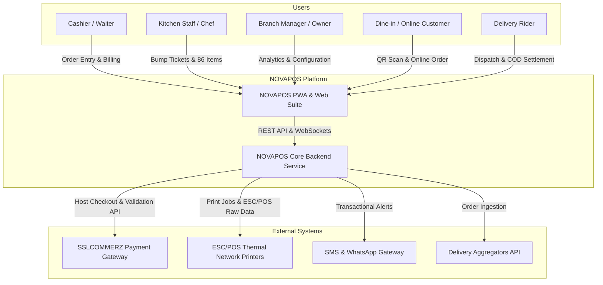
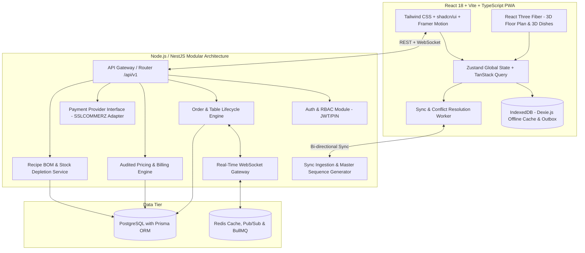
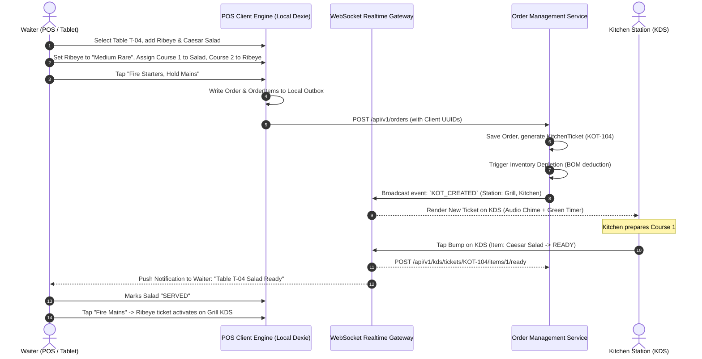
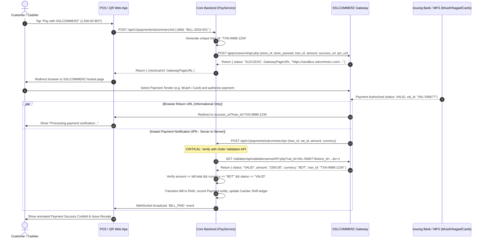
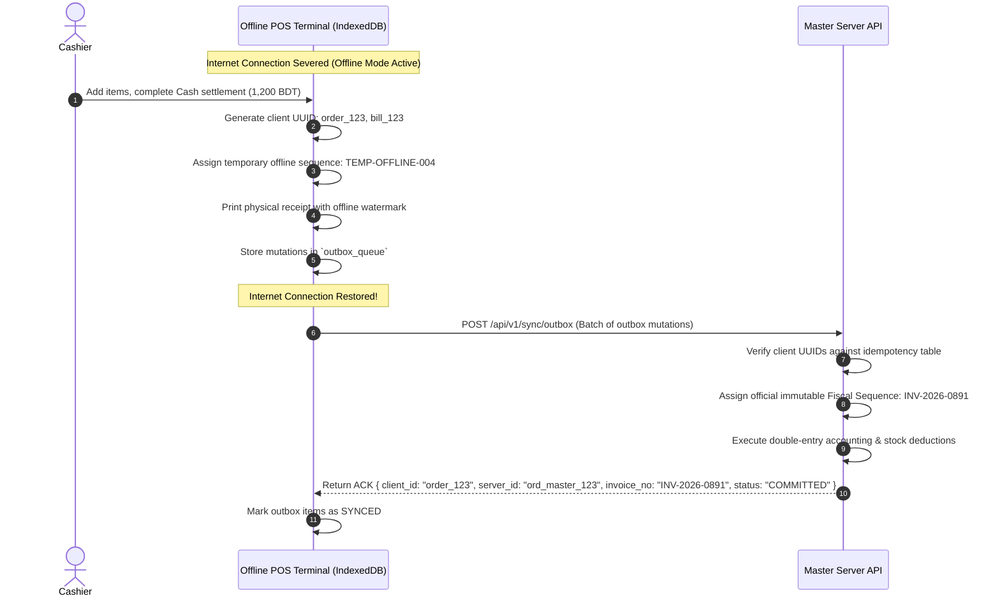

# NOVAPOS – System Architecture & Technical Design Document
**Document Path:** `/docs/architecture.md`  
**Version:** 1.0.0  
**Phase:** Phase 0 – Foundation  

---

## 1. Architectural Philosophy & Overview
NOVAPOS is designed as a **Modular Monolith** with clear domain separation, event-driven internal bus, and offline-first edge durability. It empowers single-location cafes to multi-brand enterprise franchises with 200+ concurrent terminals per branch.

### Core Architectural Pillars
1. **Speed & Ergonomics:** Client-side optimistic updates with < 50ms interaction latency.
2. **Offline Durability:** IndexedDB (`Dexie.js`) local datastore with monotonic outbox queue and automatic background synchronization.
3. **Multi-Tenant Strict Isolation:** Row-level tenant partitioning (`tenant_id`, `branch_id`) enforced across all queries and events.
4. **Realtime Pub/Sub:** WebSocket/Socket.io event mesh orchestrating cross-terminal state (POS, KDS, CFD, Handheld, QR).
5. **Fiscal & Payment Integrity:** Strict integer minor units for currency, double-entry ledgers, and zero-trust gateway settlement (SSLCOMMERZ server-side validation).

---

## 2. C4 Architecture Models

### 2.1 System Context Diagram (C4 Level 1)


### 2.2 Container Diagram (C4 Level 2)


---

## 3. High-Priority Sequence Diagrams

### 3.1 Order Taking -> Course Firing -> KDS Bump -> Notification Flow


### 3.2 Secure Payment via SSLCOMMERZ (Hosted Checkout, IPN & Server Validation)


### 3.3 Offline Outbox & Conflict Resolution Flow


---

## 4. Multi-Tenant Isolation & Security Model
- **Row-Level Tenancy:** All Prisma queries automatically filter with:
  ```typescript
  where: {
    tenantId: ctx.user.tenantId,
    ...(ctx.user.branchId ? { branchId: ctx.user.branchId } : {}),
  }
  ```
- **Password & PIN Hashing:** Passwords hashed with `Argon2id` / `Bcrypt` (cost factor 12). 4-digit PINs hashed with tenant-specific cryptographic salt.
- **Role Permissions Guard:** Decorator-driven RBAC `@RequirePermissions(Permission.BILL_VOID)` evaluated before controller entry.
- **Zero Card Data:** Complete compliance with PCI-DSS SAQ-A via hosted redirect architecture.

---

## 5. Hardware Integration Architecture
- **ESC/POS Network & USB Printers:** Native raw byte generator supporting Epson, Star, and Xprinter commands (line feeds, cut, drawer kick `\x1B\x70\x00\x19\xFA`).
- **Local Print Bridge:** Light WebSocket daemon installed on POS machine (`ws://localhost:9100`) capable of sending raw ESC/POS binary buffers directly to serial/USB ports without browser print prompt delays.
- **Customer Facing Display (CFD):** Secondary monitor synchronized via broadcast channel API (locally) or WebSocket channel (networked tablet).

---
*Architectural Baseline Established for Phase 0.*
