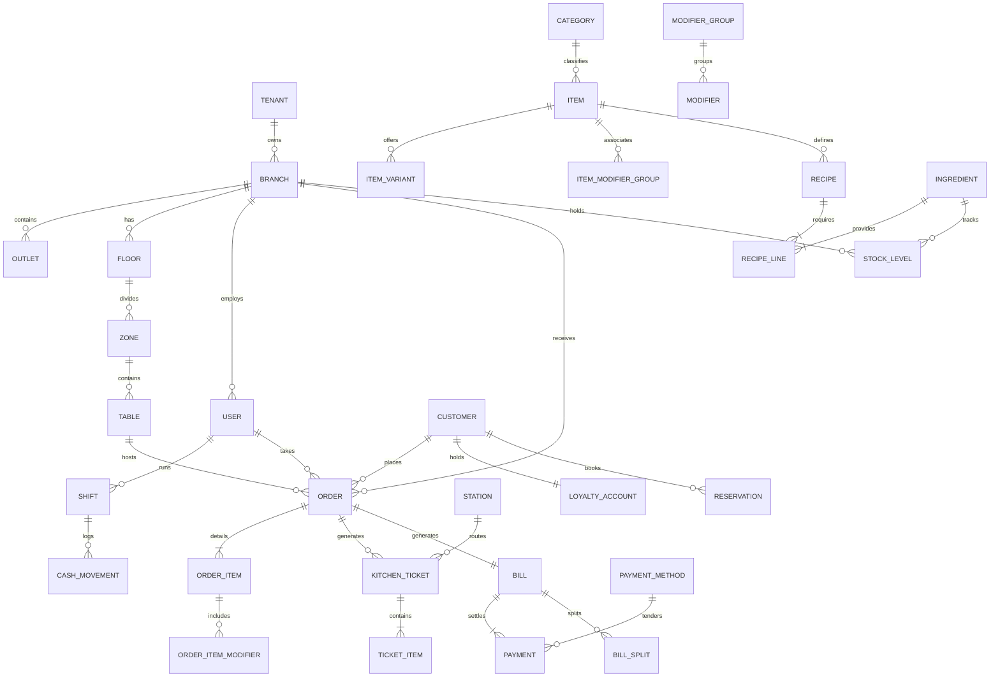

# NOVAPOS – Entity Relationship (ER) Data Model & Schema Specification
**Document Path:** `/docs/er-diagram.md`  
**Version:** 1.0.0  
**Phase:** Phase 0 – Foundation  

---

## 1. Data Modeling Principles
1. **Multi-Tenancy:** Every top-level entity references `tenant_id` (UUIDv4) and `branch_id` (UUIDv4) for row-level isolation.
2. **Financial Precision:** Every monetary value (`amount`, `price`, `tax`, `discount`, `cost`) is an **unsigned 64-bit integer** representing minor currency units (e.g., Poisha / Cents).
3. **Auditability & Soft Delete:** All tables include `created_at`, `updated_at`, `created_by`, `deleted_at` (soft delete). Sensitive entities (Orders, Bills, Stock Movements, Payments, Shifts) are immutable.
4. **Offline Resilience:** All synchronizable entities carry a `client_id` (UUIDv4) and `sync_status` (`PENDING`, `SYNCED`, `CONFLICT`).

---

## 2. Core Entity Domains & Data Dictionary

### Domain 1: Multi-Tenant Organization & Access Control
- **`Tenant`**: `id`, `name`, `subdomain`, `plan_tier`, `is_active`, `created_at`, `updated_at`.
- **`Organization`**: `id`, `tenant_id`, `legal_name`, `tax_identifier_bin`, `currency`, `timezone`.
- **`Brand`**: `id`, `tenant_id`, `organization_id`, `name`, `logo_url`, `theme_config`.
- **`Branch`**: `id`, `tenant_id`, `brand_id`, `name`, `code`, `address`, `phone`, `email`, `is_main_branch`.
- **`Outlet`**: `id`, `branch_id`, `name`, `type` (`DINE_IN`, `BAR`, `DRIVE_THRU`, `EXPRESS_COUNTER`).
- **`Device`**: `id`, `branch_id`, `device_name`, `device_fingerprint`, `type` (`POS_TERMINAL`, `KDS`, `CFD`, `TABLET`), `paired_at`, `status`.
- **`User`**: `id`, `tenant_id`, `email`, `phone`, `password_hash`, `pin_hash`, `first_name`, `last_name`, `avatar_url`, `is_active`.
- **`Role`**: `id`, `tenant_id`, `name` (`SUPER_ADMIN`, `OWNER`, `MANAGER`, `CASHIER`, `WAITER`, `CHEF`, `BARTENDER`, `INVENTORY_MGR`, `ACCOUNTANT`, `RIDER`), `is_system`.
- **`Permission`**: `id`, `code` (`ORDER_CREATE`, `ORDER_VOID`, `DISCOUNT_APPLY`, `BILL_REOPEN`, `REFUND_EXECUTE`, `REPORT_VIEW`, `SETTINGS_EDIT`).
- **`RolePermission`**: `role_id`, `permission_id`.
- **`UserRole`**: `user_id`, `role_id`, `branch_id`.
- **`Session`**: `id`, `user_id`, `device_id`, `token_hash`, `ip_address`, `expires_at`, `revoked_at`.
- **`AuditLog`**: `id`, `tenant_id`, `branch_id`, `user_id`, `action`, `entity_type`, `entity_id`, `old_values` (JSONB), `new_values` (JSONB), `ip`, `created_at`.

### Domain 2: Floor & Table Management
- **`Floor`**: `id`, `branch_id`, `name`, `level_order`, `background_grid_json`.
- **`Zone`**: `id`, `floor_id`, `name` (`MAIN_HALL`, `PATIO`, `ROOFTOP`, `VIP_LOUNGE`, `BAR`).
- **`Table`**: `id`, `zone_id`, `table_number`, `shape` (`ROUND`, `SQUARE`, `RECTANGLE`, `BOOTH`, `BAR_STOOL`), `capacity`, `coord_x`, `coord_y`, `coord_z_3d`, `rotation`, `status` (`AVAILABLE`, `OCCUPIED`, `RESERVED`, `ORDERED`, `FOOD_READY`, `BILL_REQUESTED`, `CLEANING`, `BLOCKED`).
- **`TableSession`**: `id`, `table_id`, `waiter_id`, `guest_count`, `opened_at`, `closed_at`, `status`.
- **`Reservation`**: `id`, `branch_id`, `customer_id`, `table_id`, `party_size`, `reserved_time`, `duration_minutes`, `status` (`CONFIRMED`, `SEATED`, `CANCELLED`, `NO_SHOW`), `notes`.
- **`WaitlistEntry`**: `id`, `branch_id`, `customer_name`, `phone`, `party_size`, `quoted_wait_time`, `status` (`WAITING`, `NOTIFIED`, `SEATED`, `CANCELLED`).

### Domain 3: Catalog & Menu Engineering
- **`Category`**: `id`, `tenant_id`, `parent_id`, `name_en`, `name_bn`, `display_order`, `icon`, `image_url`, `is_active`.
- **`Item`**: `id`, `category_id`, `sku`, `barcode`, `name_en`, `name_bn`, `description_en`, `description_bn`, `base_price`, `cost_price`, `tax_rule_id`, `is_veg`, `is_vegan`, `is_halal`, `spice_level`, `calories`, `prep_time_minutes`, `station_id`, `image_url`, `model_3d_url`, `is_86_sold_out`, `is_active`.
- **`ItemVariant`**: `id`, `item_id`, `name_en`, `name_bn`, `price_difference`, `sku`.
- **`ModifierGroup`**: `id`, `tenant_id`, `name_en`, `name_bn`, `min_selection`, `max_selection`, `is_required`.
- **`Modifier`**: `id`, `modifier_group_id`, `name_en`, `name_bn`, `extra_price`, `is_default`, `recipe_id`.
- **`ItemModifierGroup`**: `item_id`, `modifier_group_id`, `display_order`.
- **`Combo`**: `id`, `name_en`, `name_bn`, `combo_price`, `is_active`.
- **`MenuSchedule`**: `id`, `branch_id`, `name` (`BREAKFAST`, `LUNCH`, `HAPPY_HOUR`), `start_time`, `end_time`, `days_of_week`.
- **`PriceList`**: `id`, `branch_id`, `item_id`, `override_price`, `is_active`.

### Domain 4: Ordering & Kitchen Flow (KOT / KDS)
- **`Order`**: `id`, `client_order_uuid`, `tenant_id`, `branch_id`, `table_id`, `table_session_id`, `waiter_id`, `cashier_id`, `order_type` (`DINE_IN`, `TAKEAWAY`, `DELIVERY`, `PICKUP`, `DRIVE_THRU`, `BAR_TAB`), `status` (`DRAFT`, `PLACED`, `ACCEPTED`, `PREPARING`, `READY`, `SERVED`, `COMPLETED`, `CANCELLED`), `covers`, `order_number`, `created_at`.
- **`OrderItem`**: `id`, `order_id`, `item_id`, `variant_id`, `quantity`, `unit_price`, `discount_amount`, `tax_amount`, `final_line_price`, `notes`, `course` (`STARTER`, `MAIN`, `DESSERT`, `BEVERAGE`), `status` (`PENDING`, `FIRED`, `PREPARING`, `READY`, `SERVED`, `VOIDED`), `void_reason_id`, `voided_by_user_id`.
- **`OrderItemModifier`**: `id`, `order_item_id`, `modifier_id`, `unit_price`, `quantity`.
- **`KitchenTicket`** (KOT): `id`, `ticket_number`, `order_id`, `station_id`, `status` (`NEW`, `PREPARING`, `READY`, `BUMPED`), `fired_at`, `ready_at`, `bumped_at`.
- **`TicketItem`**: `id`, `kitchen_ticket_id`, `order_item_id`, `status`.
- **`Station`**: `id`, `branch_id`, `name` (`MAIN_KITCHEN`, `GRILL`, `BAR`, `DESSERT`, `EXPO_PASS`), `color_code`.
- **`Printer`**: `id`, `branch_id`, `name`, `type` (`ESC_POS_NETWORK`, `ESC_POS_USB`, `BLUETOOTH`), `ip_address`, `port`, `paper_width` (`80MM`, `58MM`), `assigned_stations`.

### Domain 5: Billing, Taxes & Payments
- **`TaxRule`**: `id`, `tenant_id`, `name` (`VAT_5`, `VAT_15`, `GST_18`), `rate_percentage`, `is_inclusive`, `is_active`.
- **`ChargeRule`**: `id`, `branch_id`, `name` (`SERVICE_CHARGE_10`, `PACKAGING_FEE`, `DELIVERY_FEE`), `type` (`PERCENTAGE`, `FIXED`), `amount_or_rate`.
- **`Discount`**: `id`, `tenant_id`, `name`, `type` (`PERCENTAGE`, `FLAT_AMOUNT`, `COMP_ITEM`), `value`, `max_limit`, `min_spend`, `requires_manager_pin`.
- **`Coupon`**: `id`, `discount_id`, `code`, `start_date`, `end_date`, `usage_limit`, `times_used`.
- **`Bill`**: `id`, `client_bill_uuid`, `order_id`, `fiscal_invoice_number`, `subtotal`, `discount_total`, `tax_total`, `charge_total`, `tip_amount`, `grand_total`, `rounding_difference`, `status` (`UNPAID`, `PARTIALLY_PAID`, `PAID`, `VOIDED`, `REFUNDED`), `closed_at`.
- **`BillSplit`**: `id`, `bill_id`, `split_index`, `amount`, `status` (`PENDING`, `PAID`).
- **`Payment`**: `id`, `bill_id`, `bill_split_id`, `amount`, `payment_method_id`, `tender_details` (JSONB), `status` (`INITIATED`, `AUTHORIZED`, `SETTLED`, `FAILED`), `paid_at`, `cashier_id`.
- **`PaymentMethod`**: `id`, `name` (`CASH`, `CARD`, `SSLCOMMERZ`, `BKASH`, `NAGAD`, `LOYALTY`, `HOUSE_CREDIT`), `gateway_code`, `is_active`.
- **`Refund`**: `id`, `payment_id`, `amount`, `reason_code`, `approved_by_user_id`, `created_at`.
- **`Shift`**: `id`, `branch_id`, `cashier_id`, `terminal_device_id`, `opened_at`, `closed_at`, `opening_float`, `expected_cash`, `actual_cash`, `variance`, `notes`, `status` (`OPEN`, `CLOSED`).
- **`CashMovement`**: `id`, `shift_id`, `type` (`FLOAT_IN`, `SAFE_DROP`, `PAY_OUT`, `NO_SALE_KICK`), `amount`, `reason`, `authorized_by_id`, `created_at`.

### Domain 6: Customer CRM & Online Channels
- **`Customer`**: `id`, `tenant_id`, `phone`, `first_name`, `last_name`, `email`, `total_visits`, `lifetime_spend`, `dietary_notes`, `created_at`.
- **`Address`**: `id`, `customer_id`, `label` (`HOME`, `OFFICE`), `street`, `zone`, `lat`, `lng`.
- **`LoyaltyAccount`**: `id`, `customer_id`, `points_balance`, `tier` (`SILVER`, `GOLD`, `PLATINUM`), `updated_at`.
- **`LoyaltyTransaction`**: `id`, `loyalty_account_id`, `order_id`, `points_earned`, `points_redeemed`, `type`.
- **`GiftCard`**: `id`, `tenant_id`, `card_code_hash`, `initial_balance`, `current_balance`, `is_active`, `expires_at`.
- **`Campaign`**: `id`, `tenant_id`, `title`, `channel` (`SMS`, `EMAIL`, `WHATSAPP`), `target_segment`, `sent_at`.
- **`Feedback`**: `id`, `order_id`, `customer_id`, `food_rating`, `service_rating`, `ambiance_rating`, `comments`, `created_at`.
- **`DeliveryOrder`**: `id`, `order_id`, `rider_id`, `delivery_address_id`, `delivery_fee`, `driver_status` (`ASSIGNED`, `PICKED_UP`, `EN_ROUTE`, `DELIVERED`), `live_lat`, `live_lng`.
- **`Rider`**: `id`, `user_id`, `vehicle_type`, `license_no`, `current_status` (`OFFLINE`, `IDLE`, `ON_DELIVERY`).
- **`DeliveryZone`**: `id`, `branch_id`, `zone_name`, `radius_km`, `min_order_amount`, `delivery_fee`.

### Domain 7: Inventory & Recipe Management
- **`Ingredient`**: `id`, `tenant_id`, `sku`, `name`, `base_unit` (`KG`, `LITER`, `GRAM`, `PIECE`), `cost_per_unit`, `current_stock`, `reorder_threshold`, `par_level`.
- **`Recipe`**: `id`, `item_id`, `variant_id`, `yield_servings`, `instructions`.
- **`RecipeLine`**: `id`, `recipe_id`, `ingredient_id`, `quantity`, `wastage_percentage`.
- **`StockLevel`**: `id`, `branch_id`, `ingredient_id`, `quantity_on_hand`, `storage_bin`.
- **`StockMovement`**: `id`, `branch_id`, `ingredient_id`, `type` (`PURCHASE_IN`, `SALE_DEDUCTION`, `WASTAGE_SPOIL`, `TRANSFER_IN`, `TRANSFER_OUT`, `AUDIT_ADJUSTMENT`), `quantity_change`, `cost_per_unit`, `reference_id`, `created_at`.
- **`StockCount`**: `id`, `branch_id`, `conducted_by_id`, `type` (`FULL`, `CYCLE`, `BLIND`), `discrepancy_total_cost`, `completed_at`.
- **`WastageLog`**: `id`, `branch_id`, `ingredient_id`, `quantity`, `reason` (`BURNT`, `EXPIRED`, `SPILLED`), `cost`, `reported_by_id`.
- **`Supplier`**: `id`, `tenant_id`, `name`, `contact_person`, `phone`, `email`, `payment_terms`.
- **`PurchaseOrder`**: `id`, `branch_id`, `supplier_id`, `po_number`, `status` (`DRAFT`, `SUBMITTED`, `RECEIVED`, `CLOSED`), `total_cost`.
- **`GoodsReceipt`**: `id`, `purchase_order_id`, `grn_number`, `received_date`, `verified_by_id`.
- **`Transfer`**: `id`, `from_branch_id`, `to_branch_id`, `status` (`DISPATCHED`, `RECEIVED`, `REJECTED`), `sent_at`.

### Domain 8: HR, Accounting, Config & Integrations
- **`StaffProfile`**: `id`, `user_id`, `branch_id`, `designation`, `hourly_wage`, `joining_date`.
- **`RosterShift`**: `id`, `branch_id`, `user_id`, `start_time`, `end_time`, `status`.
- **`Attendance`**: `id`, `user_id`, `clock_in`, `clock_out`, `break_minutes`, `overtime_minutes`.
- **`Expense`**: `id`, `branch_id`, `category` (`UTILITIES`, `MAINTENANCE`, `PETTY_PURCHASE`), `amount`, `receipt_attachment_url`, `created_at`.
- **`JournalEntry`**: `id`, `tenant_id`, `branch_id`, `account_code`, `debit_amount`, `credit_amount`, `description`, `reference_id`, `entry_date`.
- **`Notification`**: `id`, `user_id`, `title`, `body`, `type` (`STOCK_ALERT`, `KDS_DELAY`, `APPROVAL_REQ`), `is_read`.
- **`Webhook`**: `id`, `tenant_id`, `target_url`, `event_type`, `secret_key`, `is_active`.
- **`ApiKey`**: `id`, `tenant_id`, `key_hash`, `label`, `permissions_json`, `expires_at`.
- **`IntegrationConfig`**: `id`, `tenant_id`, `provider` (`SSLCOMMERZ`, `UBER_EATS`, `FOODPANDA`), `credentials_encrypted` (JSONB), `is_sandbox`.
- **`Setting`**: `id`, `branch_id`, `key`, `value` (JSONB).

---

## 3. Visual Mermaid Entity Relationship Diagram

---
*Data Model Baseline Established for Phase 0.*
